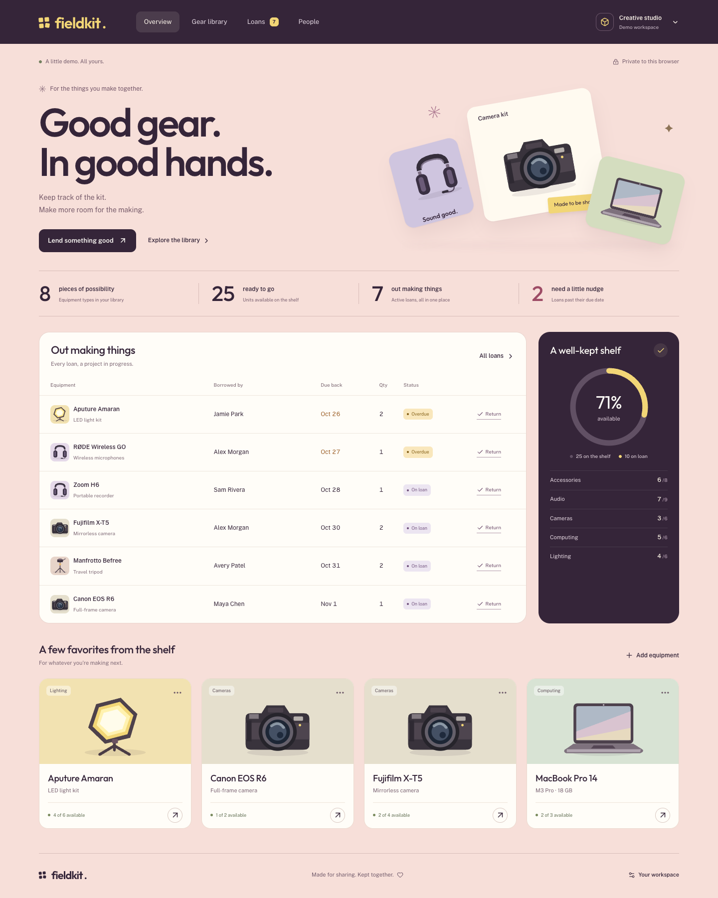

# Fieldkit

[](https://github.com/bagdaulet-dev/fieldkit/actions/workflows/ci.yml)

**Good gear. In good hands.** A Java equipment-lending workspace for a club, studio or small team. Keep equipment, borrowers, due dates and available stock together.



## What it does

- Add equipment with a category, model, storage location, description and total quantity.
- Search the gear library and filter by category or availability.
- Add borrowers with a name and optional team label.
- Check out a quantity of equipment to a borrower with a due date and notes.
- Return the whole loan quantity once, restoring available stock.
- View active, overdue and returned loans, with private stock summaries.
- Edit inventory without reducing total stock below units already on loan.
- Export the workspace as JSON or confirm deletion of all its records.
- Explore fictional equipment and loans in a separate private demo workspace.

## Stack

| Layer          | Technology                                                          |
| -------------- | ------------------------------------------------------------------- |
| Backend        | Java 21 target, Spring Boot 4.1.2, Spring MVC                       |
| Database       | MySQL 8.4, Spring JDBC / JdbcTemplate                               |
| Schema changes | Liquibase with plain SQL changes                                    |
| Sessions       | Spring Session JDBC, HttpOnly SameSite cookies and CSRF             |
| Interface      | React, TypeScript, Vite, custom CSS and original SVG equipment art  |
| Tests          | TestNG, real HTTP requests, concurrent requests, restart regression |
| Delivery       | Maven wrapper, Docker Compose, GitHub Actions                       |

The local preview uses **H2 file storage** to keep Docker stopped. It runs the same service logic, JDBC repositories and Liquibase changes. The complete MySQL stack is verified separately. Each mode has its own database; records are not copied automatically between modes.

## Start the local preview

Requirements: **JDK 21 or later**, **Node 24**, npm and `unzip` for the pinned Maven ZIP distribution.

```sh
git clone https://github.com/bagdaulet-dev/fieldkit.git
cd fieldkit
./scripts/preview.sh
```

Open **http://localhost:8082/** and choose **Explore the demo**, or add your own equipment and borrowers. The launcher installs frontend dependencies, builds the interface, packages Java and starts the server on localhost. Stop it with `Ctrl+C`.

If the project is already built:

```sh
umask 077
mkdir -p .local
chmod 700 .local
cp target/fieldkit.jar .local/fieldkit-preview.jar
java -Xms64m -Xmx256m -jar .local/fieldkit-preview.jar --spring.profiles.active=preview --debug=false
```

For frontend development, keep the Java server on port 8082 and run `npm run dev`; Vite serves port 5174 and proxies the API. Rebuild and restart the Java archive to preview a new production frontend build.

## Run the full MySQL stack

Requirements: Docker Desktop with Compose and Python 3 for local credential generation. Stop another server using port 8082 first, or set `APP_PORT=8083`.

```sh
python3 scripts/setup-env.py
docker compose up --build -d --wait
```

The setup script creates `.env` with distinct random database passwords and mode 0600. It never overwrites an existing file. Compose waits for MySQL, applies Liquibase migrations and starts the non-root app with its own readiness check. MySQL is private to Docker’s network, and the application is exposed only on localhost.

```sh
docker compose logs --tail=60 app
docker compose stop
```

Stopping keeps database data. Quit Docker Desktop afterward to release its VM resources. `docker compose down` also removes the containers and network while keeping the database volume. Adding `--volumes` erases that volume, so use it only for intentional data removal.

## Workspace access and retention

Each browser receives its own workspace through a server-side session. There is no registration or borrower login. Another browser starts empty. The session cookie lasts up to seven days; loss or expiry of that cookie removes access to its workspace. Export records you want to retain.

An hourly cleanup removes workspaces inactive for seven days; cleanup starts one minute after the application starts. Their records remain on disk while the app is stopped. A confirmed workspace deletion removes its equipment, people and loans immediately and invalidates the session. See [security and data retention](docs/security.md).

## Verify the project

```sh
npm ci --ignore-scripts
npm run build
./mvnw -B -ntp fmt:check verify
npm run format:check
npm audit --audit-level=high
python3 scripts/audit-maven.py
```

With a running preview and Chrome installed:

```sh
npm run test:browser
```

The browser test uses fictional data and isolated browser sessions. It checks checkout, return, stock reconciliation, editing, search, reload, export, workspace isolation/deletion and responsive layouts at 320, 390 and 768 pixels. Set `BASE_URL` to test another local address. CI installs the Chromium build matching the pinned Playwright version.

Run the same Java API and concurrency tests against a disposable MySQL database:

```sh
docker compose -f compose.test.yaml up -d --wait
TEST_STORAGE=mysql MYSQL_HOST=127.0.0.1 MYSQL_PORT=3311 MYSQL_DATABASE=fieldkit_test MYSQL_USER=fieldkit_test MYSQL_PASSWORD=fieldkit-tests-only MYSQL_SSL_MODE=DISABLED ./mvnw -B -ntp verify
docker compose -f compose.test.yaml down
```

These public test credentials belong only to the disposable test database. The regular application uses generated private credentials. The database restart regression uses a separate temporary H2 file in both test runs.

## API and architecture

[API reference](docs/api.md) · [Architecture](docs/architecture.md) · [Operations](docs/operations.md) · [Verification](docs/verification.md)

The OpenAPI document is served at **http://localhost:8082/openapi.json**. API requests use the same origin as the interface. Call `GET /api/session` first, retain its cookie and send the returned token as `X-CSRF-TOKEN` on every write.

```text
backend/src/main/java/dev/bagdaulet/fieldkit/
  ApiController.java           HTTP routes and request contracts
  InventoryService.java        Validated equipment and borrower writes
  LoanService.java             Transactional checkout and return
  InventoryRepository.java     Owner-scoped inventory reads
  LoanRepository.java          Owned loan queries and filters
  WorkspaceService.java        Private workspaces and expiry cleanup
backend/src/main/resources/
  db/changelog/                Liquibase SQL and session schemas
  static/openapi.json          Versioned REST contract
backend/src/test/               TestNG API and persistence tests
frontend/src/                  React interface, SVG art and responsive styles
scripts/                       Preview, browser test, dependency audit and health probe
```

Every mutation locks the private workspace row; checkout and return also lock their affected records. Available quantities and loan records change in one database transaction. UUID lookups always include the workspace filter, and composite foreign keys enforce that loans reference equipment and borrowers in that workspace.

The CI workflow runs formatting, preview and MySQL tests, audits, browser checks and a Docker build. The manual publishing workflow verifies the project before publishing a container to GitHub Container Registry. The project is published at [bagdaulet-dev/fieldkit](https://github.com/bagdaulet-dev/fieldkit). No remote server deployment is configured.

Bundled fonts, icons and copied session SQL are credited in [THIRD_PARTY_NOTICES.md](THIRD_PARTY_NOTICES.md).

## Security

[Security boundaries and deployment guidance](docs/security.md) cover workspace isolation, CSRF, validation, secrets, retention and production configuration. No API keys are embedded in the client. Real database credentials stay in ignored server configuration. Run `python3 scripts/check-secrets.py` before publishing; CI checks publishable files, the built frontend and Git history with checksum-verified Gitleaks. Native preview files are restricted to your OS account. This is a browser-session workspace, with no staff login or cross-device recovery.
