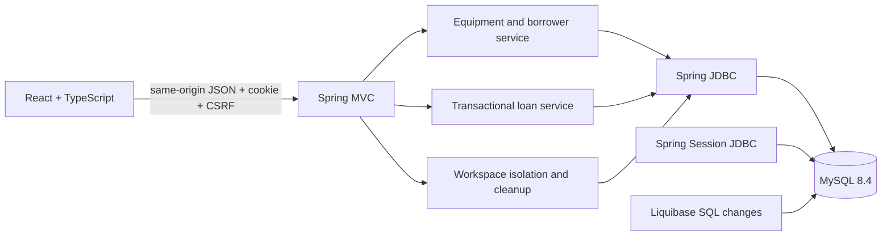
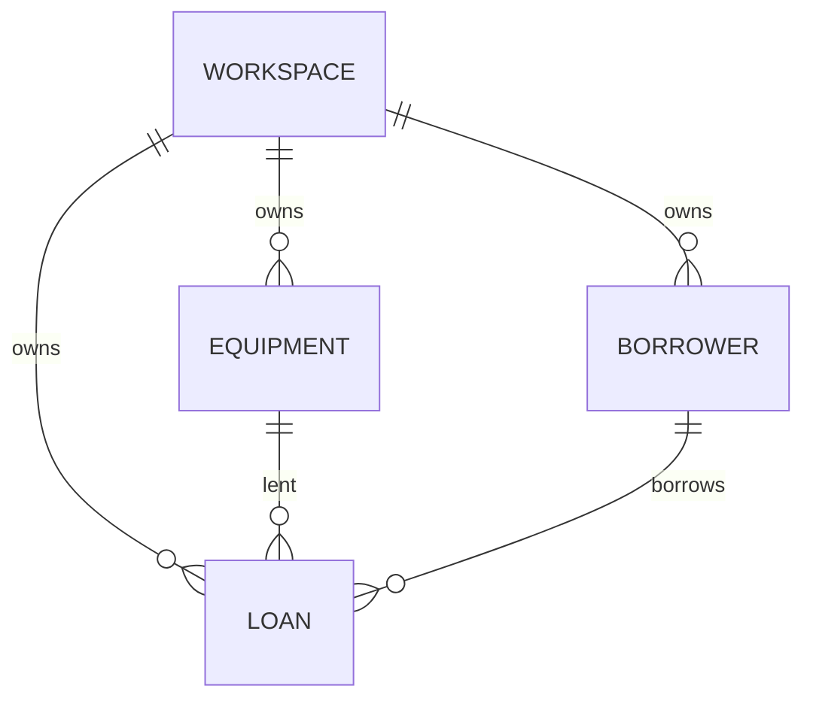

# Architecture

The full stack serves the built frontend and API from one Spring Boot application. The preview swaps MySQL for an H2 file database while keeping the same service, JDBC and migration code. Vite proxies the API only during frontend development.

## Data model

Equipment stores total and available quantities. Loans store a positive quantity, due date, server checkout time, optional notes and nullable return time. Status is derived: returned when `returned_at` exists, overdue when unreturned and due before today, active otherwise. ACTIVE list filtering includes overdue loans.

UUIDs identify records. Every query also includes the private workspace ID. Composite foreign keys make a loan’s equipment and borrower belong to the same workspace. Database checks prevent negative stock, stock above total, and invalid quantity ranges. Referenced people/equipment cannot be deleted, preserving loan history.

Spring Session stores its own tables. A workspace key is derived server-side from the unpredictable session identifier; clients cannot choose it or submit it as a record owner.

## Transaction boundaries

Every write locks the workspace row first. This serializes mutations within a small workspace, keeping capacity checks and workspace deletion consistent. Separate workspaces can mutate independently. Checkout and return additionally lock the affected records.

Checkout validates input, locks the workspace and equipment, verifies the borrower and availability, decrements stock, then inserts the loan. Any failure rolls the whole operation back. Return checks that the loan is still active, marks its return timestamp and restores its full quantity in the same transaction. A repeat returns a conflict. Equipment quantity edits preserve the current checked-out quantity.

This favors clear consistency rules over maximum write parallelism inside one workspace. TestNG checks competing requests and a deliberately rejected SQL insert to prove rollback behavior.

## Code boundaries

Controllers translate HTTP requests to typed records. Inputs and Queries validate external values; Jackson rejects unknown fields and scalar coercion. InventoryRepository and LoanRepository own reusable scoped read queries; services use injected JdbcTemplate for transactional mutations and summaries. SQL values are bound parameters. The only dynamic table identifier is chosen from a private fixed allowlist.

WorkspaceService manages session scope and bounded expiry cleanup. DemoService inserts clearly fictional records only into an empty private workspace. DashboardService aggregates owned records. Errors are structured and generic at unexpected failure boundaries.

## Frontend

`api.ts` owns same-origin fetches, CSRF headers, timeouts and cancellation. `data.ts` owns session initialization and real workspace reads. Focused components implement the overview, collections, editors, details and confirmed returns/deletion. Query-string navigation preserves the current view on reload; filters are temporary state.

Native dialogs handle keyboard containment and Escape; cleanup restores focus to a usable trigger or main content. SVG category illustrations use no external images. Outfit and Public Sans are bundled locally. Short entry/hover motion respects reduced motion; the interface has no continuous decorative loop.
